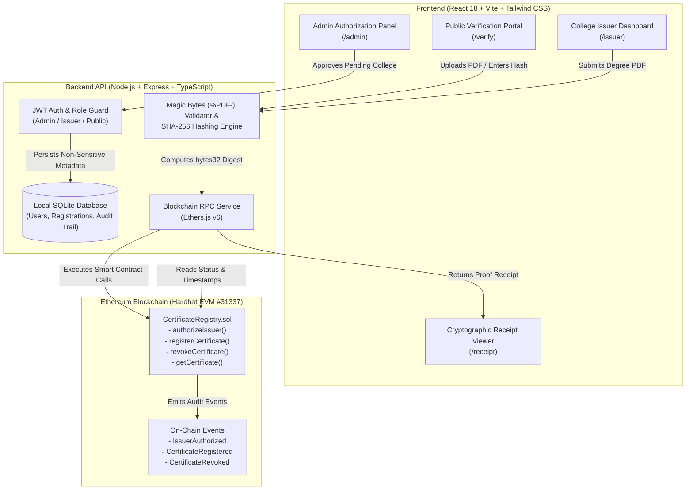
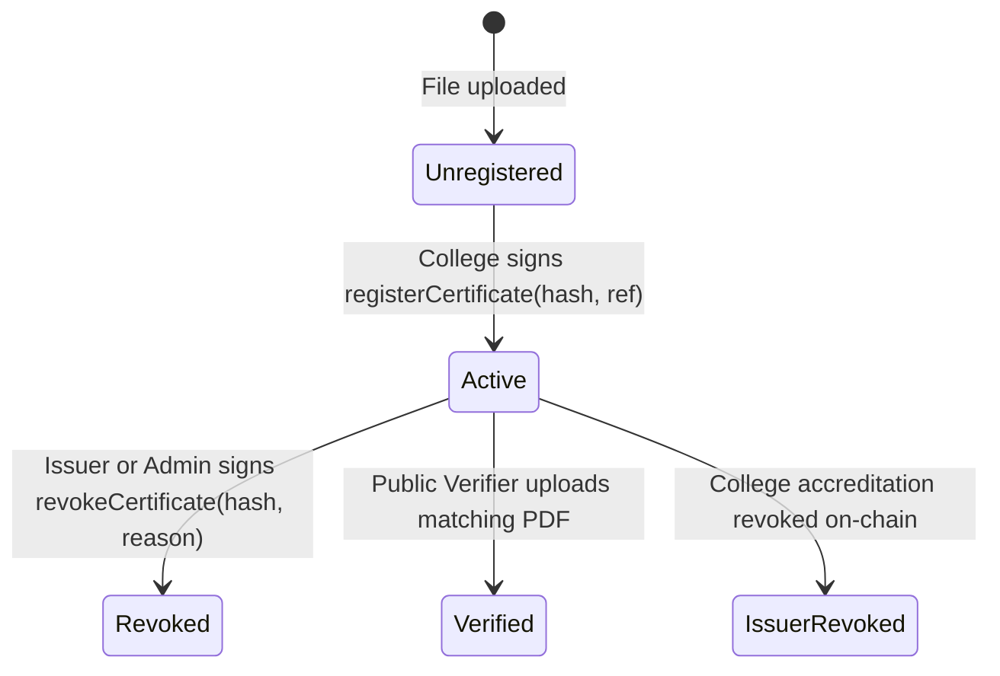

# ChainProof Architecture & Technical Specification

ChainProof is a decentralized, tamper-evident certificate verification system that anchors SHA-256 cryptographic hashes of digital credentials to an Ethereum smart contract.

---

## 1. High-Level Architecture

---

## 2. Core Components

### A. Smart Contract (`CertificateRegistry.sol`)
- **Language**: Solidity `^0.8.24` (EVM target: Paris)
- **Framework**: Hardhat 2.29
- **Access Control**: Owner / Administrator and authorized college issuers.
- **Gas Optimization**: Uses custom Solidity errors (`UnauthorizedCaller()`, `ZeroAddressNotAllowed()`, `CertificateAlreadyRegistered()`, etc.) instead of verbose revert strings.
- **Privacy Design**: Absolutely zero Personally Identifiable Information (PII) is stored in contract state or event logs.

### B. Backend API (`backend/`)
- **Runtime**: Node.js v24 LTS + Express + TypeScript
- **Hashing Engine**: Uses `crypto.createHash('sha256')` directly against raw file buffers.
- **Security Check**: Enforces magic byte verification (`0x25 0x50 0x44 0x46` for `%PDF-`). Spoofed text files renamed to `.pdf` are rejected before hashing.
- **Database**: SQLite in Write-Ahead Logging (`WAL`) mode via `better-sqlite3`. Stores user credentials (bcrypt hashed), issuer accreditation records, and offline registration references.

### C. Frontend Web Application (`frontend/`)
- **Framework**: React 18, Vite 5, TypeScript
- **Styling**: Tailwind CSS with customized black-and-emerald glassmorphism palette (`#080B0A` background, `#22C55E` accent, translucent panels, fine borders).
- **Icons**: Lucide React.
- **Print Layout**: Custom `@media print` styling for offline verification receipts.

---

## 3. Cryptographic State Machine

